# Especificación Técnica de Arquitectura de Base de Datos e Integración de Tutorías

## 1. Visión General de la Arquitectura de Datos Dual (Bounded Context)

El **Sistema de Tutorías del TecNM Campus Monclova** opera bajo el patrón de diseño **Bounded Context** (Dominio Limitado Autónomo). Para garantizar el aislamiento de responsabilidades, alta disponibilidad y prevenir alteraciones no autorizadas en el sistema escolar central, la arquitectura utiliza una **Estrategia de Base de Datos Dual**:

```
┌──────────────────────────────────────┐        ┌──────────────────────────────────────┐
│  BASE DE DATOS PRINCIPAL (HEREDADA)  │        │   BASE DE DATOS EXCLUSIVA TUTORÍAS   │
│         (85 Tablas / Legacy)         │        │         (3 Tablas / Módulos)         │
├──────────────────────────────────────┤        ├──────────────────────────────────────┤
│ - Alumnos, Docentes, Periodos        │        │ - tutoring_deliverables (Compliance) │
│ - Asignaturas, Files, Kardex         │        │ - tutoring_referrals (Referrals)    │
│ - Lectura Exclusiva (Read-Only API)  │        │ - tutoring_failure_reports (Metrics) │
└──────────────────┬───────────────────┘        └──────────────────┬───────────────────┘
                   │                                               │
                   │           LLAVES LÓGICAS DE INTEGRACIÓN       │
                   └───────────────────────┬───────────────────────┘
                                           ▼
                       ┌───────────────────────────────────────┐
                       │      Capa de Servicios .NET 10        │
                       │     (Resolución DTO a Nivel API)      │
                       └───────────────────────────────────────┘
```

### Principios Fundamentales
1. **Desacoplamiento Estructural (Loose Coupling):** La BD de Tutorías no crea Foreign Keys (`CONSTRAINT FK`) físicas dirigidas a la BD Principal. En su lugar, almacena **Llaves Lógicas** (`docente_clave`, `matricula`, `periodo_id`, `clave_materia`, `file_id`).
2. **Consultas a Nivel Aplicación (Application-Level Joins):** La API REST en .NET 10 mantiene dos cadenas de conexión distintas (`MainDbContext` y `TutoringDbContext`). Los servicios de C# realizan consultas asíncronas paralelas y combinan los datos en DTOs antes de enviarlos al Frontend Vue 3.
3. **Auditoría Inmutable Estándar (10 Campos):** Todas las tablas del dominio de tutorías implementan obligatoriamente los 10 campos de auditoría y borrado lógico (*Soft Delete*) exigidos por los estándares del campus.

---

## 2. Diagrama Entidad-Relación Integrado (Mermaid ERD)

```mermaid
erDiagram
    %% ======================================================
    %% ENTIDADES RELEVANTES DE LA BASE DE DATOS PRINCIPAL (READ-ONLY)
    %% ======================================================
    MAIN_Alumnos {
        varchar Matricula PK "Llave Primaria Escolar"
        varchar Nombre "Nombre del Alumno"
        varchar Apellidos "Apellidos del Alumno"
        int CarreraID "ID de Carrera"
    }

    MAIN_Docentes {
        varchar Clave PK "Llave Primaria Docente"
        varchar Nombre "Nombre del Profesor"
        varchar Apellidos "Apellidos del Profesor"
        varchar Correo "Correo Institucional"
    }

    MAIN_Periodos {
        int PeriodoID PK "ID del Periodo Lectivo"
        varchar Periodo "Nombre del Periodo (ej. Ene-Jun 2026)"
    }

    MAIN_Asignaturas {
        varchar ClaveMateria PK "Llave Primaria Asignatura"
        varchar Asignatura "Nombre Oficial de la Materia"
    }

    MAIN_Files {
        int ID PK "ID Autoincremental del Binario"
        nvarchar Name "Nombre del Archivo"
        varchar ContentType "Tipo MIME"
    }

    %% ======================================================
    %% MÓDULOS Y TABLAS EXCLUSIVAS DE TUTORÍAS (READ/WRITE)
    %% ======================================================
    tutoring_deliverables {
        uuid id PK "Identificador Único Global"
        varchar docente_clave FK "Llave Lógica -> MAIN_Docentes.Clave"
        int periodo_id FK "Llave Lógica -> MAIN_Periodos.PeriodoID"
        int file_id FK "Llave Lógica -> MAIN_Files.ID (Nullable)"
        varchar report_type "Tipo de Anexo u Oficio"
        smallint reporting_month "Mes del Reporte (1-12)"
        varchar status "Pending, OnTime, Late"
        int delay_days "Días de Retraso Acumulados"
        timestamptz created_at "Auditoría: Creación"
        varchar created_by "Auditoría: Creador"
        varchar created_ip "Auditoría: IP Creador"
        timestamptz updated_at "Auditoría: Modificación"
        varchar updated_by "Auditoría: Modificador"
        varchar updated_ip "Auditoría: IP Modificador"
        boolean is_deleted "Auditoría: Borrado Lógico"
        timestamptz deleted_at "Auditoría: Eliminación"
        varchar deleted_by "Auditoría: Eliminador"
        varchar deleted_ip "Auditoría: IP Eliminador"
    }

    tutoring_referrals {
        uuid id PK "Identificador Único Global"
        int periodo_id FK "Llave Lógica -> MAIN_Periodos.PeriodoID"
        varchar matricula FK "Llave Lógica -> MAIN_Alumnos.Matricula"
        varchar tutor_clave FK "Llave Lógica -> MAIN_Docentes.Clave"
        varchar detection_source "Tutor, Maestro"
        varchar support_area "Psychology, SocialWork, Nursing, Tutoring"
        varchar referral_reason "Academic, Emotional, Personal, Discipline"
        text observations "Detalles y Motivo de Atención"
        varchar contact_phone "Teléfono Celular"
        varchar status "InTracking, Resolved"
        timestamptz created_at "Auditoría"
        varchar created_by "Auditoría"
        varchar created_ip "Auditoría"
        timestamptz updated_at "Auditoría"
        varchar updated_by "Auditoría"
        varchar updated_ip "Auditoría"
        boolean is_deleted "Auditoría"
        timestamptz deleted_at "Auditoría"
        varchar deleted_by "Auditoría"
        varchar deleted_ip "Auditoría"
    }

    tutoring_failure_reports {
        uuid id PK "Identificador Único Global"
        int periodo_id FK "Llave Lógica -> MAIN_Periodos.PeriodoID"
        varchar docente_clave FK "Llave Lógica -> MAIN_Docentes.Clave"
        varchar clave_materia FK "Llave Lógica -> MAIN_Asignaturas.ClaveMateria"
        varchar grupo "Grupo Evaluado (ej. 1A)"
        smallint reporting_month "Mes Evaluado (1-12)"
        int total_students "Total Inscritos"
        int failed_students "Total Reprobados"
        decimal failure_percentage "Porcentaje Calculado"
        varchar failed_units "Unidades Reprobadas (I, II, etc.)"
        varchar risk_level "Low, Medium, High, Critical"
        text preventive_actions "Estrategias de Asesoría"
        timestamptz created_at "Auditoría"
        varchar created_by "Auditoría"
        varchar created_ip "Auditoría"
        timestamptz updated_at "Auditoría"
        varchar updated_by "Auditoría"
        varchar updated_ip "Auditoría"
        boolean is_deleted "Auditoría"
        timestamptz deleted_at "Auditoría"
        varchar deleted_by "Auditoría"
        varchar deleted_ip "Auditoría"
    }

    %% ======================================================
    %% RELACIONES LÓGICAS INTER-BASE DE DATOS
    %% ======================================================
    MAIN_Docentes ||--o{ tutoring_deliverables : "1:N (Llave Lógica: Clave)"
    MAIN_Periodos ||--o{ tutoring_deliverables : "1:N (Llave Lógica: PeriodoID)"
    MAIN_Files |o--o{ tutoring_deliverables : "0:N (Llave Lógica: ID)"

    MAIN_Alumnos ||--o{ tutoring_referrals : "1:N (Llave Lógica: Matricula)"
    MAIN_Docentes ||--o{ tutoring_referrals : "1:N (Llave Lógica: Clave)"
    MAIN_Periodos ||--o{ tutoring_referrals : "1:N (Llave Lógica: PeriodoID)"

    MAIN_Periodos ||--o{ tutoring_failure_reports : "1:N (Llave Lógica: PeriodoID)"
    MAIN_Docentes ||--o{ tutoring_failure_reports : "1:N (Llave Lógica: Clave)"
    MAIN_Asignaturas ||--o{ tutoring_failure_reports : "1:N (Llave Lógica: ClaveMateria)"
```



---

## 3. Especificación Detallada de Tablas y Módulos

### Módulo 1: Cumplimiento Docente (`Compliance`)
* **Tabla:** `tutoring_deliverables`
* **Propósito:** Registrar el estado de entrega de los 7 anexos/formatos obligatorios que los 54 docentes deben subir mensualmente.
* **Control de Tiempo:** Evalúa las cargas realizadas entre los días 5 y 10 del mes. Si la entrega se realiza después del día 10, calcula automáticamente los días de retraso (`delay_days`) e incrementa el semáforo de mora.

#### Diccionario de Columnas
| Columna | Tipo de Dato | Nulabilidad | Valor por Defecto | Descripción y Restricciones |
| :--- | :--- | :---: | :--- | :--- |
| `id` | `uuid` | `NOT NULL` | `gen_random_uuid()` | Clave Primaria Única (UUID v4). |
| `docente_clave` | `varchar(64)` | `NOT NULL` | -- | Llave Lógica ➜ `MAIN_Docentes.Clave`. |
| `periodo_id` | `integer` | `NOT NULL` | -- | Llave Lógica ➜ `MAIN_Periodos.PeriodoID`. |
| `file_id` | `integer` | `NULL` | `NULL` | Llave Lógica ➜ `MAIN_Files.ID`. Se llena al cargar el archivo. |
| `report_type` | `varchar(32)` | `NOT NULL` | -- | Enum: `PlanTrabajo`, `DiagnosticoInicial`, `Anexo14`, `Anexo15`, `Anexo19AMensual`, `Asistencia`, `Anexo19Final`. |
| `reporting_month` | `smallint` | `NOT NULL` | -- | Mes del reporte (Rango: `1` a `12`). |
| `status` | `varchar(16)` | `NOT NULL` | `'Pending'` | Enum: `'Pending'` (Pendiente), `'OnTime'` (En Tiempo), `'Late'` (Con Retraso). |
| `delay_days` | `integer` | `NOT NULL` | `0` | Días de mora acumulados (Día de subida - 10). |

---

### Módulo 2: Canalizaciones a Áreas de Apoyo (`Referrals`)
* **Tabla:** `tutoring_referrals`
* **Propósito:** Unificar el expediente de atenciones estudiantiles enviadas a Psicología, Trabajo Social, Enfermería o Tutorías de nivelación.
* **Aislamiento por Rol:** Permite que las áreas de apoyo consulten únicamente los casos pertenecientes a su departamento mediante filtros LINQ inyectados por el JWT del especialista.

#### Diccionario de Columnas
| Columna | Tipo de Dato | Nulabilidad | Valor por Defecto | Descripción y Restricciones |
| :--- | :--- | :---: | :--- | :--- |
| `id` | `uuid` | `NOT NULL` | `gen_random_uuid()` | Clave Primaria Única (UUID v4). |
| `periodo_id` | `integer` | `NOT NULL` | -- | Llave Lógica ➜ `MAIN_Periodos.PeriodoID`. |
| `matricula` | `varchar(32)` | `NOT NULL` | -- | Llave Lógica ➜ `MAIN_Alumnos.Matricula`. |
| `tutor_clave` | `varchar(64)` | `NOT NULL` | -- | Llave Lógica ➜ `MAIN_Docentes.Clave`. |
| `detection_source` | `varchar(32)` | `NOT NULL` | -- | Enum: `Tutor`, `Maestro`. |
| `support_area` | `varchar(32)` | `NOT NULL` | -- | Enum: `Psychology`, `SocialWork`, `Nursing`, `Tutoring`. |
| `referral_reason` | `varchar(32)` | `NOT NULL` | -- | Enum: `Academic`, `Emotional`, `Personal`, `Discipline`. |
| `observations` | `text` | `NULL` | `NULL` | Descripción detallada de la problemática. |
| `contact_phone` | `varchar(20)` | `NULL` | `NULL` | Teléfono de contacto directo del alumno. |
| `status` | `varchar(16)` | `NOT NULL` | `'InTracking'` | Enum: `'InTracking'` (En Seguimiento), `'Resolved'` (Terminado). |

---

### Módulo 3: Métricas y Alertas de Reprobación (`Metrics`)
* **Tabla:** `tutoring_failure_reports`
* **Propósito:** Almacenar las evaluaciones mensuales por materia/grupo para calcular porcentajes de reprobación y detonar alertas preventivas en asignaturas críticas (Cálculo, Dibujo, etc.).

#### Diccionario de Columnas
| Columna | Tipo de Dato | Nulabilidad | Valor por Defecto | Descripción y Restricciones |
| :--- | :--- | :---: | :--- | :--- |
| `id` | `uuid` | `NOT NULL` | `gen_random_uuid()` | Clave Primaria Única (UUID v4). |
| `periodo_id` | `integer` | `NOT NULL` | -- | Llave Lógica ➜ `MAIN_Periodos.PeriodoID`. |
| `docente_clave` | `varchar(64)` | `NOT NULL` | -- | Llave Lógica ➜ `MAIN_Docentes.Clave`. |
| `clave_materia` | `varchar(32)` | `NOT NULL` | -- | Llave Lógica ➜ `MAIN_Asignaturas.ClaveMateria`. |
| `grupo` | `varchar(16)` | `NOT NULL` | -- | Identificador de grupo (ej. `1A`, `3B`). |
| `reporting_month` | `smallint` | `NOT NULL` | -- | Mes de evaluación (Rango: `1` a `12`). |
| `total_students` | `integer` | `NOT NULL` | `0` | Total de alumnos inscritos en el grupo. |
| `failed_students` | `integer` | `NOT NULL` | `0` | Total de alumnos con unidades reprobadas. |
| `failure_percentage`| `numeric(5,2)` | `NOT NULL` | `0.00` | Porcentaje de reprobación: `(failed / total) * 100`. |
| `failed_units` | `varchar(64)` | `NULL` | `NULL` | Unidades reprobadas en formato comas (ej. `I, III`). |
| `risk_level` | `varchar(16)` | `NOT NULL` | `'Low'` | Enum: `'Low'`, `'Medium'`, `'High'`, `'Critical'`. |
| `preventive_actions`| `text` | `NULL` | `NULL` | Estrategias docentes para reducir el índice. |

---

## 4. Estándar Inmutable de Auditoría (10 Campos Obligatorios)

Todas las tablas anteriores incluyen los siguientes 10 campos de infraestructura para garantizar la rastreabilidad exigida en auditorías institucionales:

```sql
created_at   timestamptz NOT NULL DEFAULT CURRENT_TIMESTAMP,
created_by   varchar(254) NOT NULL,
created_ip   varchar(45) NOT NULL,
updated_at   timestamptz NULL,
updated_by   varchar(254) NULL,
updated_ip   varchar(45) NULL,
is_deleted   boolean NOT NULL DEFAULT false,
deleted_at   timestamptz NULL,
deleted_by   varchar(254) NULL,
deleted_ip   varchar(45) NULL
```

### Funcionalidad de Auditoría
* **Auto-Sellado (`created_by` / `created_ip`):** El servicio `CurrentUserService` de .NET extrae del HttpContext la IP pública del cliente y el correo del JWT activo para poblar estos datos automáticamente.
* **Borrado Lógico (`Soft Delete`):** Cuando un registro se elimina, el sistema ejecuta un `UPDATE` fijando `is_deleted = true`, guardando la fecha, IP y usuario en `deleted_*`. Ningún registro se destruye físicamente (`DELETE`) para cumplir la política de retención de 2 a 3 años.

---

## 5. Tabla de Mapeo de Claves Lógicas Inter-Base de Datos

| Campo en BD Tutorías | Tabla de BD Principal | Campo en BD Principal | Propósito de la Integración |
| :--- | :--- | :--- | :--- |
| `docente_clave` | `Docentes` | `Clave` | Obtener Nombre, Apellidos, Correo y Departamento del profesor. |
| `matricula` | `Alumnos` | `Matricula` | Obtener Nombre, Apellidos, Carrera y Expediente del estudiante. |
| `periodo_id` | `Periodos` | `PeriodoID` | Validar vigencia del semestre y agrupar reportes comparativos. |
| `clave_materia` | `Asignaturas` | `ClaveMateria` | Obtener Nombre Oficial de la materia (Cálculo, Dibujo, etc.). |
| `file_id` | `Files` | `ID` | Descargar o previsualizar el PDF/Word adjunto mediante el visor seguro. |

---

## 6. Mantenimiento y Triggers Automatizados

Para garantizar que el campo `updated_at` se actualice de forma transparente a nivel de motor PostgreSQL sin depender exclusivamente del ORM, se ejecuta el siguiente Trigger en todas las tablas de Tutorías:

```sql
CREATE OR REPLACE FUNCTION update_updated_at_column()
RETURNS TRIGGER AS $$
BEGIN
    NEW.updated_at = CURRENT_TIMESTAMP;
    RETURN NEW;
END;
$$ LANGUAGE plpgsql;
```